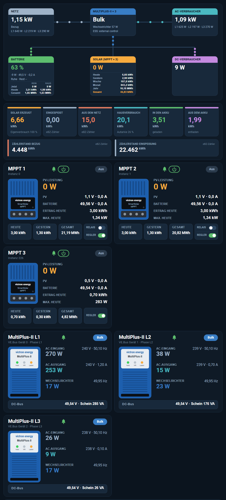

# Victron Solar Cards

Home Assistant dashboard cards that show a **Victron system in VRM style** – animated energy flow, today's energy, every MPPT, every MultiPlus phase and the system controls. Everything is drawn live as SVG, no images needed.
*Deutsch weiter unten.*



| Card | Shows |
|---|---|
| `custom:victron-flow-card` | Grid, MultiPlus, AC loads, battery, solar and DC loads with animated power flow; battery in/out today & total, solar yield today … total |
| `custom:victron-energy-card` | Energy of the day: solar, fed in, from grid, consumption (with self-consumption & self-sufficiency), battery in/out, meter readings |
| `custom:victron-mppt-card` | One SmartSolar MPPT: state, alarms, on/off, PV power, PV and battery voltage/current, yield today/yesterday/total, optional relay |
| `custom:victron-multiplus-card` | One MultiPlus / Quattro phase: AC in, AC out, inverter, DC bus, alarms |
| `custom:victron-control-card` | Inverter mode (On / Charger only / Inverter only / Off), *charge from grid* switch, max. charge current slider – every action asks for confirmation |

Each card switches automatically between a **desktop** and a **phone** layout (or set `layout: desktop | mobile`). Tap any value to open its entity. German and English texts.

Battery modules and Lynx fuses are separate cards: [pylontech-card](https://github.com/ossilampe/pylontech-card) and [lynx-card](https://github.com/ossilampe/lynx-card).

## Installation

**HACS / Marketplace:** add `https://github.com/ossilampe/victron-solar-cards` as a custom repository of type **Dashboard** (HA 2026.11+: Settings → Marketplace → *Add from link*), install, reload the browser.

**Manual:** copy `victron-solar-cards.js` to `/config/www/` and add the resource `/local/victron-solar-cards.js?v=1.0.0` (JavaScript module).

## Configuration

The cards do not depend on one specific Victron integration – you pick the sensors in the card editor (or YAML). Only set what you have; missing parts are left out.

```yaml
type: custom:victron-flow-card
grid_power: [sensor.grid_l1, sensor.grid_l2, sensor.grid_l3]   # one sensor or one per phase
load_power: [sensor.ac_load_l1, sensor.ac_load_l2, sensor.ac_load_l3]
pv_power: sensor.dc_pv_power
battery_power: sensor.battery_power
battery_soc: sensor.battery_soc
battery_voltage: sensor.battery_voltage
battery_current: sensor.battery_current
battery_state: sensor.battery_state          # charging / discharging / idle
battery_time_to_go: sensor.battery_time_to_go  # seconds
inverter_dc_power: sensor.vebus_dc_power
inverter_power: [sensor.vebus_0_power, sensor.vebus_1_power, sensor.vebus_2_power]
vebus_state: sensor.vebus_state
ess_state: sensor.system_state
dc_loads: sensor.dc_loads                     # optional
battery_in_today: sensor.battery_in_today
battery_out_today: sensor.battery_out_today
battery_in_total: sensor.battery_charge_energy
battery_out_total: sensor.battery_discharge_energy
pv_today: sensor.pv_today
pv_yesterday: sensor.pv_yesterday
pv_week: sensor.vrm_week_solar_yield
pv_month: sensor.vrm_month_solar_yield
pv_year: sensor.vrm_year_solar_yield
pv_total: sensor.pv_total
multi_title: MULTIPLUS-II × 3
solar_title: SOLAR (MPPT × 3)
```

```yaml
type: custom:victron-energy-card
solar_today: sensor.pv_today
feed_in_today: [sensor.meter_export_today, sensor.vrm_today_grid_energy_out]   # first available value is used
grid_in_today: [sensor.meter_import_today, sensor.vrm_today_grid_energy_in]
consumption_today: sensor.house_consumption_today
battery_in_today: sensor.battery_in_today
battery_out_today: sensor.battery_out_today
meter_import: sensor.meter_import_total     # optional
meter_export: sensor.meter_export_total     # optional
meter_name: eBZ meter
```

```yaml
type: custom:victron-mppt-card
name: MPPT 1
subtitle: Instance 0
state: sensor.victron_solarcharger_state_0
pv_power: sensor.victron_solarcharger_yield_power_0
pv_voltage: sensor.victron_solarcharger_pv_voltage_0
pv_current: sensor.victron_solarcharger_pv_current_0
battery_voltage: sensor.victron_solarcharger_battery_voltage_0
battery_current: sensor.victron_solarcharger_battery_current_0
yield_today: sensor.victron_solarcharger_yield_today_0
yield_yesterday: sensor.victron_solarcharger_yield_yesterday_0
yield_total: sensor.mppt1_total_yield
max_power_today: sensor.victron_solarcharger_maxpower_today_0
mode: select.victron_solarcharger_mode_0       # ON / OFF, power button
relay: switch.mppt1_relay                      # optional
alarms: [sensor.victron_solarcharger_alarm_0]
error: sensor.victron_solarcharger_errorcode_0
```

```yaml
type: custom:victron-multiplus-card
name: MultiPlus-II L1
subtitle: VE.Bus device 0 · phase L1
state: sensor.victron_vebus_state
input_voltage: sensor.vebus_input_voltage_l1
input_frequency: sensor.vebus_input_frequency_l1
input_power: sensor.vebus_input_power_l1
output_voltage: sensor.vebus_output_voltage_l1
output_current: sensor.vebus_output_current_l1
output_power: sensor.vebus_output_power_l1
output_frequency: sensor.vebus_output_frequency_l1
inverter_power: sensor.vebus_0_inverter_power
apparent_power: sensor.vebus_output_apparent_power_l1
dc_voltage: sensor.vebus_dc_voltage
alarms: [sensor.vebus_alarm_l1_overload, sensor.vebus_alarm_lowbattery]
error: sensor.vebus_error
```

```yaml
type: custom:victron-control-card
mode: select.victron_vebus_mode          # options ON / CHARGER / INVERTER / OFF
force_charge: switch.ess_force_charge     # optional
charge_limit: number.ess_max_charge_current
charge_target: input_number.charge_target # optional: slider writes here, an automation applies it
max_current: 400
alarms: [sensor.vebus_alarm_overload, sensor.vebus_alarm_lowbattery]
error: sensor.vebus_error
```

All cards also take `layout: auto | desktop | mobile` and `language: auto | de | en`.

---

# Deutsch

Dashboard-Karten für Home Assistant, die eine **Victron-Anlage im VRM-Stil** zeigen: animierter Energiefluss, Energie des Tages, jeder MPPT, jede MultiPlus-Phase und die Steuerung (Modus, Laden aus dem Netz, max. Ladestrom – jeweils mit Rückfrage).

- Die Karten sind nicht an eine bestimmte Victron-Integration gebunden: Du wählst deine Sensoren im Karten-Editor. Was du nicht hast, lässt du weg.
- Jede Karte wechselt selbst zwischen **Desktop- und Handy-Ansicht**.
- Antippen eines Wertes öffnet die Entität.
- Akku-Module und Lynx-Sicherungen gibt es als eigene Karten: [pylontech-card](https://github.com/ossilampe/pylontech-card) und [lynx-card](https://github.com/ossilampe/lynx-card).

**Installation:** In HACS dieses Repository als *Benutzerdefiniertes Repository* (Typ *Dashboard*) hinzufügen, ab HA 2026.11 unter Einstellungen → Marketplace → *Über Link hinzufügen*. Optionen siehe Beispiele oben.

## License

MIT
